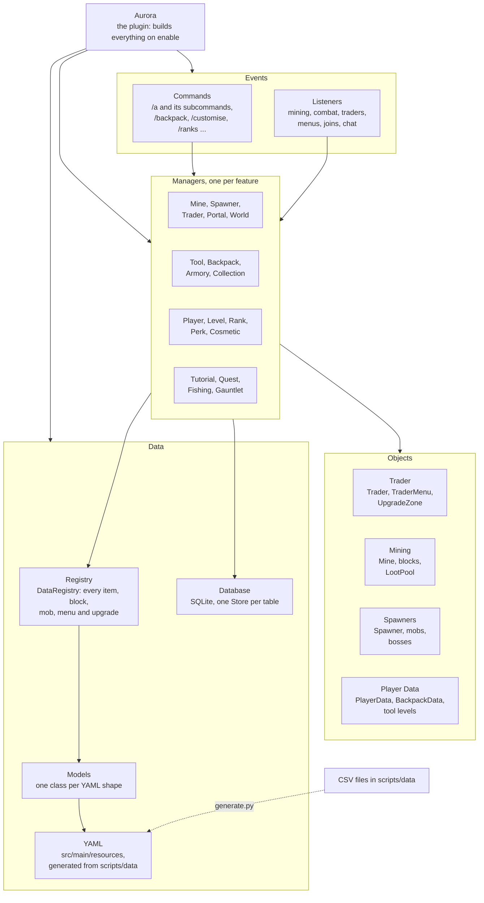

# Aurora


A sky-mining RPG plugin for Paper 26.3. Mine resources, spend them on upgrades for tools that stay with you, and fight custom mobs across the islands.

## Features

- **Mines** that reset on a timer, gated by Fortune against each block's density
- **Custom mobs and spawners** with their own health, attack levels and drops
- **Upgrades, not items**: each zone's trader sells levels for the pick, axe, sword, shield and armour, priced by a formula from a time target per zone
- **Twelve regions built**, three released at launch: the Origin Isles, then two branches that add up, Gormak for fighting and Verdant Groves for gathering
- **Tutorial and questline**: new players are walked through their first upgrade, then led zone by zone through the Origin Isles with a particle trail
- **Backpack** that holds mined resources outside the inventory
- **Collections** of every resource, with a Gear tab where weapons dropped by mobs are unlocked for good
- **Levels and Essence**, playtime ranks, an Essence shop with mounts, Dash and Double Jump, and cosmetics in `/customise`
- **Bosses** summoned with a key, some with phases or abilities
- **Fishing**, a side quest with one spot a realm and its own rod upgrades
- **The Gauntlet**, a mode of its own in its own world: fast runs up a 100 floor tower, alone or in a co-op party of up to 4, with elites and their affixes, mutators, bosses with abilities, kill combos, a bonus Shard Hoarder and heat levels, boons and care packages during a run; gear and perks from a forge, a starting kit, talents, a Shard Shop, altars mid-run, checkpoints, daily challenges, achievements and weekly boards between runs; spectating; milestones that pay into the main game; a PvP zone with its own damage rules, kill rewards and streaks; and rated 1v1 duels
- **PvP** everywhere but safe zones, with nothing lost on death
- **Staff tools**: ranks that carry their permissions, mutes, kicks, bans and a punishment history
- **Player menu** with `/aurora` or `/a`

## Requirements

- Java 25
- Maven
- Python 3 with PyYAML, for the game data

## Commands

Every command, and the order to build a region in, is in [docs/COMMANDS.md](docs/COMMANDS.md). How the game progresses and how it is tuned is in [docs/PROGRESSION.md](docs/PROGRESSION.md), selling donor ranks through a store in [docs/STORE.md](docs/STORE.md), and moving a map in and setting it up in [docs/MAP.md](docs/MAP.md).

## Game data

All game data lives in CSVs under `scripts/data/`, sorted into folders. The scripts find a file by its name, so a file can move between folders freely.

| Folder | Holds |
|---|---|
| `world/` | Where the game happens: `zones.csv` (each zone's time target, mines, mobs and price scales), `realms.csv` (which worlds share tool levels), `warps.csv`, `blocks.csv` (what every block drops and its density) |
| `items/` | Everything a player can hold: `resources.csv` and `resources_special.csv` (keys), `tools.csv` (the tools that level up), `enchants.csv`, and the `gear_*.csv` files for what mobs wear and drop, food, rods and the backpack |
| `mobs/` | One file per region: health, defence, attack, equipment and drops |
| `shops/` | What traders offer: `upgrades.csv` (every upgrade step and what it costs in), `traders.csv`, the menu layouts in `guis_shops*.csv` and their `icons.csv` |
| `fishing/` | The fishing spots, their fish and the rod's upgrades |
| `gauntlet/` | The Gauntlet: its mobs, floors, gear and gear levels, boons, care packages and milestones |

Some numbers are filled in by the balance scripts in `scripts/balance/` (zone prices, collection tiers, Essence values, fishing and Gauntlet numbers); [docs/PROGRESSION.md](docs/PROGRESSION.md) says which. Edit the CSVs, then generate the YAML:

```bash
python scripts/generate.py
```

Never edit the generated YAML in `src/main/resources/`.

## Architecture

The code is laid out by feature: `core/` wires everything together and holds the data layer, `common/` holds what features share, and each folder under `features/` is one part of the game with its own manager, listeners and menus.



| Group | Where | What it is |
|---|---|---|
| Aurora | `core/Aurora.java` | Creates the database, the registry and every manager, then registers commands and listeners |
| Commands | `features/system/commands/`, and beside each feature | Parse what was typed and call a manager |
| Listeners | beside each feature | Turn Bukkit events into manager calls |
| Managers | `features/<feature>/*Manager.java` | The rules of one feature and its state in memory |
| Objects | `features/trader`, `features/mine`, `features/spawner`, `features/player` | What managers hold: a mine, a spawner, a trader, a player's data |
| Registry | `core/DataRegistry.java`, `core/data/` | Loads the YAML once and answers every lookup |
| Models | `core/models/` | The shape of each YAML file |
| YAML | `src/main/resources/` | Generated from the CSVs, never edited by hand |
| Database | `core/database/` | SQLite: one Store class per table, everything players and admins change |

Logic with no Bukkit in it (level curve, price of perks, collection tiers, tool levels, loot rolls) sits in small classes of its own so it can be unit tested.

## Build and run

`scripts/server.sh` builds the plugin and runs the local test server in `LocalServer/`:

```bash
scripts/server.sh build     # build, copies the jar and YAML into LocalServer
scripts/server.sh start     # start in the background
scripts/server.sh stop      # stop cleanly
scripts/server.sh restart   # stop, build, start
```

With the server running, data-only changes can be loaded live with `python scripts/generate.py --live` then `/refresh` in game.

## Deploying

```bash
scripts/server.sh build
python scripts/deploy.py bundle      # target/aurora-deploy.zip
```

Stop the live server, unzip `aurora-deploy.zip` over its folder, start it. The zip holds the jar and the game data YAML: the plugin only writes its YAML when a file is missing, so copying the jar alone keeps the old data.

Or send it straight to the host over SFTP, with the login in `scripts/deploy.ini` (gitignored, written on the first run). The host's server stays up while files go up, and is down only for the swap:

```
python scripts/deploy.py stage --all         # build, then send what changed to a staging folder, server running
                                             # stop the host's server
python scripts/deploy.py swap                # move it in and merge the database, takes seconds
                                             # start the host's server
python scripts/deploy.py stage --dry-run     # list what changed here since the last deploy
```

`stage` sends the jar, the game data YAML and, with `--worlds`, the game world files that differ from the host's: changed since the last deploy (a hash in `target/deploy-uploaded.json`) or another size there. Nothing live is touched until `swap`, so a server started or restarted meanwhile breaks nothing, and a dropped connection is resumed by running `stage` again. `swap` moves the files in, removes world files LocalServer does not have and every world not named in `deploy.ini` (never the vanilla overworld, nether or end, nor the worlds under `keep`), and with `--db` merges LocalServer's game data (mines, spawners, traders, portals) into the host's `mines.db`, keeping its players, after saving the host's copy to `LocalServer/aurora-backups/`. `upload` with the same flags does both in one go, for a host that is already stopped.

Back up before every deploy. On the live server's host, after `save-off` and `save-all flush` in the console (then `save-on`):

```bash
python scripts/deploy.py backup <server folder>
```

This writes the database and worlds to `<server folder>/aurora-backups/` and keeps the newest 14. For the local server, `scripts/server.sh backup` does the saving steps itself. To restore, stop the server and unzip a backup over its folder.

## Tests

```bash
mvn test
```

CI runs the data check, build and tests on every push.

## Planning

Ideas and design notes for later regions are in [DESIGN.md](DESIGN.md).
